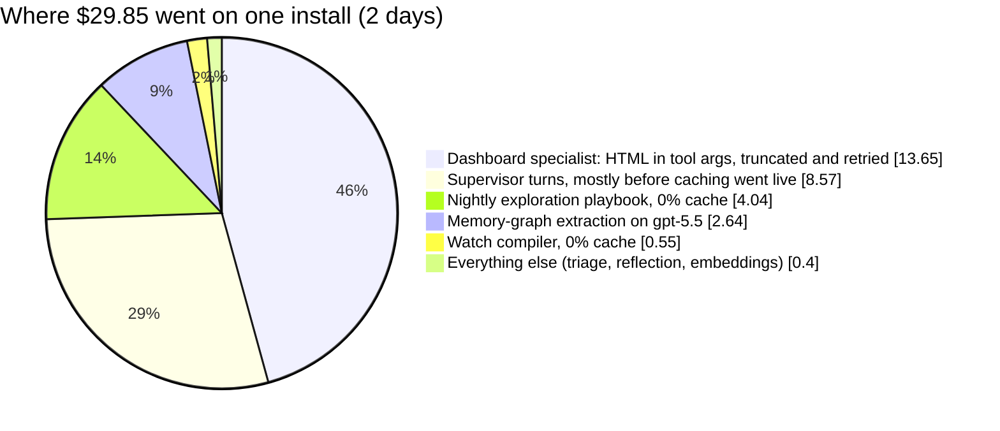
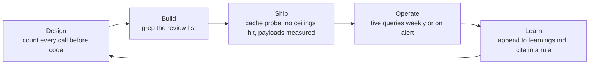

<div align="center">

# 🧮 llm-token-economy

**A Claude Code skill that keeps LLM agent systems from quietly burning money, and gets smarter after every incident.**

[](#install)
[](LICENSE)
[](references/learnings.md)
[](#how-it-keeps-learning)

*Seven rules, four phase checklists, five SQL queries, and a log of real failures with the rule each one produced.*

</div>

---

## Why this exists

Agent systems do not get expensive because the model writes long answers. They get expensive because of **structure**:

- a loop that re-sends its whole conversation uncached on every step,
- a tool that returns 60,000 characters that every later step re-reads,
- a specialist that regenerates a whole HTML page inside a tool argument and retries when it does not fit,
- a pipeline that runs the priciest model after every turn to extract a fact nobody reads.

This skill came out of a real production analysis in October 2026. Two client installs of a LangGraph supervisor-with-specialists product were spending **$20 to $30 a day** on a handful of users. Everyone suspected the per-turn memory and chat history. The usage ledger said otherwise: four structural defects were about **80% of spend**; memory and history were under 5%.



The fixes were not clever. They were the same handful of disciplines, applied everywhere instead of in one place. This skill writes them down so the next system starts with them, and it has a protocol for adding the next failure to the list.

---

## What's inside

```
llm-token-economy/
├── SKILL.md                      # the rules, the phase checklists, the learning protocol
├── references/
│   ├── learnings.md              # the living incident log (L-001 … L-016 and counting)
│   ├── measurement.md            # ledger schema, the five queries, the healthy-loop signature
│   └── anthropic-levers.md       # official facts: caching, TTLs, effort, batch, max_tokens (dated)
├── scripts/
│   └── ledger_queries.sql        # the queries as a runnable psql file
└── evals/
    └── evals.json                # three test prompts for benchmarking the skill
```

Claude loads `SKILL.md` when the skill triggers and reads the references on demand, so the always-on cost of carrying this skill is about 100 words of description.

---

## Install

The skill is a plain folder with a `SKILL.md`. Claude Code picks it up from either location:

**For every project on your machine (user level):**

```bash
git clone https://github.com/naman113/llm-token-economy.git ~/.claude/skills/llm-token-economy
```

**For one repository (project level, versioned with the code):**

```bash
git clone https://github.com/naman113/llm-token-economy.git .claude/skills/llm-token-economy
```

Or copy the folder anywhere Claude Code looks for skills (`.claude/skills/`, `.agents/skills/`, `.cursor/skills/`, `.github/skills/`, `.codex/skills/`). Start a new Claude Code session and `llm-token-economy` appears in the skills list. Invoke it directly with `/llm-token-economy`, or let it trigger on its own.

On Windows the user-level path is `C:\Users\<you>\.claude\skills\llm-token-economy`.

---

## When it triggers

The description is deliberately pushy, because Claude tends to under-trigger skills. It loads when you:

- design, write, review or deploy code that calls a model: an agent loop, a supervisor or specialist, a tool, a background job, a memory or extraction pipeline, a report or dashboard generator, a retry loop;
- say a product is **"token hungry"**, ask **why the bill is high**, or plan a cost optimisation;
- pick a model or an effort level, or set a token budget;
- want to **log a cost incident** so the rules improve.

Example prompts that should pull it in:

> "I'm adding a report-builder specialist that writes a 5-page markdown report and calls `save_report(markdown, title)`. Review it for cost before I build it."

> "Our Anthropic bill tripled this month. We have a per-call `llm_usage` table. Where do I start without dropping quality?"

> "Yesterday the nightly summariser retried the same batch all night during a rate limit and burned $40. Log this in the token skill."

---

## The seven rules

Each rule exists because something went wrong and was measured. The "taught by" column points at the entry in [`references/learnings.md`](references/learnings.md).

| # | Rule | Taught by | The number |
|---|------|-----------|------------|
| **R1** | **Measure first, from the usage fields, per call.** Your own ledger with the four token kinds, role, feature and run id. Read the healthy-loop signature on every loop, after every deploy. | L-002 | A shipped cache fix missed one install for a whole day; one SQL query found it. |
| **R2** | **One construction path for every model call, and it caches.** Explicit breakpoint on the static prefix, automatic caching on the tail, byte-identical `system`/`tools`/`model` for the conversation. | L-002, L-003 | Cache go-live cut supervisor cost per call **$0.167 → $0.043** (−74%). Loops outside the main graph ran at **0% cache**. |
| **R3** | **Never make the model emit a bulk artefact as a tool argument.** Specs, handles and patches instead. `max_tokens` is a backstop; `stop_reason: max_tokens` is a failed attempt, never a blind retry. | L-001, L-007 | **17 calls at exactly 16,000 output tokens, $7.08, nothing produced.** The spec path built the same thing for **$0.85**. |
| **R4** | **Bound every tool result in code**, and keep stable reference data in the cached prefix, not in a per-run dump. | L-004, L-009 | A tool whose 20k cap was never enforced returned **62,074 chars**; runs that called it cost **3.2×**. |
| **R5** | **Fewer, larger steps; caps and budgets that mean something.** Batch work inside tools, parallel tool calls, step/retry/delegation caps in code, budgets by cost. | L-005, L-006, L-008 | **63% of supervisor calls returned ≤200 tokens and cost 39% of spend.** A budget counting cache reads at full weight hit 201k on a 4-call run. |
| **R6** | **Cheapest adequate model per role, decided by A/B, frontier-at-low-effort first.** Background pipelines never inherit the main agent's frontier model by default. | L-005, L-016 | Graph extraction on the priciest model was **13 to 16% of daily spend**. Haiku matched Opus on quick lookups **6/6**, lost on heavy ones. |
| **R7** | **Background work is gated, debounced, capped and batched.** No reflection on trivial turns, attempt caps on every retry path, Batch API for nightly work, delete jobs nothing reads. | L-005, L-010, L-011 | **428 failed calls** re-sent every 10 s during an outage; a nightly community rebuild with no reader. |

The full text of each rule, with the *why*, is in [`SKILL.md`](SKILL.md).

---

## The workflow



Each phase has a checklist in `SKILL.md`. The build-phase list is a set of grep targets that are defects until justified, for example:

- `create_react_agent(` or `messages.create(` outside the shared factory
- `datetime.now`, `uuid4`, unsorted `json.dumps` anywhere that feeds `system` or `tools`
- `code: str` / `html: str` / `content: str` arguments on save or preview tools
- a budget that sums `total_tokens` (cache reads at full weight)
- "at most N rounds" in prompt text with no code behind it

---

## Measure before you optimise

Everything in this skill starts from a per-call ledger written by the model factory, never by callers:

```sql
CREATE TABLE llm_usage (
  ts timestamptz, provider text, model text, agent text, feature text,
  run_id bigint, input_tokens int, output_tokens int,
  cache_read_tokens int, cache_write_tokens int,
  latency_ms int, cost_usd numeric, error text
);
```

Five queries, in order, usually name the top three causes in minutes ([`references/measurement.md`](references/measurement.md), runnable in [`scripts/ledger_queries.sql`](scripts/ledger_queries.sql)):

1. **Spend by role, model and feature**: who carries the money, and whether it is input, output or writes.
2. **Cache health per role**: any multi-step loop above ~10% uncached has a defect.
3. **Run shape**: calls per run, and the share of cost carried by near-empty dispatch steps.
4. **Ceilings**: repeated outputs at exactly a round number are `max_tokens` truncations you paid for.
5. **Per-step growth and run anatomy**: which tool added 20k tokens, where the retries are.

### The healthy-loop signature

On a cached agent loop, consecutive calls look like this:

| Call | `input_tokens` | `cache_read` | `cache_write` |
|-----:|---------------:|-------------:|--------------:|
| 1 | 2 to 4 | 0 | whole prompt |
| 2 | 2 to 4 | call 1's total | previous output + new tool result |
| n | 2 to 4 | growing | one step's delta |

Anything else is a defect with a known shape: large `input_tokens` with constant `cache_read` means the system prefix is cached and the conversation is not; `cache_write` near the whole conversation on every call means the prefix is being rewritten; a single write of tens of thousands of tokens means an oversized tool result just landed.

---

## Lever order: free wins before tradeoffs

Taken from Anthropic's published cost-optimisation guidance and confirmed on our own ledger. The order is load-bearing.

| Order | Lever | Type | What it does |
|------:|-------|------|--------------|
| 1 | Prompt caching, everywhere, verified from usage | free win | Reprices the quadratic part of loop cost to ~5% of base input |
| 2 | Input hygiene | free win | Documents behind tools, tool search above ~10k schema tokens, narrow accessors, token counting as an ingestion gate |
| 3 | Loop hygiene | free win | Subagents for bulky steps, parallel tool calls, compaction only for long sessions (context editing is a window tool, not a saver) |
| 4 | Output hygiene | free win | Specs over prose, `max_tokens` as backstop, stop-sequence early exits |
| 5 | Batch API | free win | 50% off every token, cache included, for anything nobody is waiting on |
| 6 | Effort and task budgets | tradeoff | Sweep effort per route on an eval before touching the model |
| 7 | Model choice | tradeoff | Last. Frontier at low effort first, then one tier down, per completed task, priced on the tail |

The dated facts behind this (cache minimums, TTL economics, invalidation hierarchy, per-model effort defaults, what returns a 400) are in [`references/anthropic-levers.md`](references/anthropic-levers.md). Re-verify prices against the live docs before quoting them.

---

## How it keeps learning

The log is the asset. Rules without the incident behind them get argued away; incidents without a rule get repeated.

After any cost incident, ledger analysis, A/B result or production surprise, tell Claude:

> "Log this in the token skill."

It appends an entry in this format, cites it under the rule it changes, and bumps the date and count at the top of `SKILL.md`:

```markdown
## L-NNN  <short title>
- Date: YYYY-MM-DD
- System: <product, component, model>
- Symptom: <what was seen>
- Evidence: <numbers from the ledger, logs or code, with where they came from>
- Root cause: <mechanism, file:line if known>
- Fix: <what was or should be changed; one-setting rollback if any>
- Rule: <the generalisation, and which SKILL.md rule it feeds>
- Status: open | fixed <date> | verified <date> | proposed
```

Positive results count too: an A/B that showed a cheaper setting held quality is a learning, and so is a lever that did not pay off (see L-015, where server-side context editing cost more than it saved, exactly as the docs warn).

---

## Results from the first application

| What | Before | After | Source |
|------|--------|-------|--------|
| Supervisor cost per call, conversation cache | $0.167 | $0.043 | L-002 |
| One dashboard build | $2.27 avg (HTML path), up to $4.87 | $0.85 (spec path) | L-001 |
| Heavy SQL question | $0.258 | $0.185 (Data Agent on Sonnet) | L-014 |
| Long investigation, same trajectory, cache vs none | $0.813 | $0.462 | L-015 |
| Estimated day at equal quality | $20 to $25 | $6 to $8 | analysis |

The last row is an estimate from the measured levers, stated as such. Everything above it was measured.

---

## FAQ

**Is this Anthropic-only?**
The rules are provider-agnostic; the facts sheet is Claude-first because that is what was measured. Pull requests adding an OpenAI or Gemini facts sheet are welcome, in the same dated format.

**Does it change my code?**
No. It is guidance Claude follows while it designs, reviews or debugs. The measurement queries are the only "code", and they are read-only SQL.

**Will it slow Claude down?**
It adds the `SKILL.md` body to context only when it triggers, and reads references on demand. That is the point of the progressive-disclosure layout.

**Why a skill and not a blog post?**
Because a blog post is read once. A skill is in the loop every time a model call gets written, and it has a place to put the next failure.

---

## Contributing

Pull requests are welcome, especially:

- **New learnings.** One entry per distinct failure or measured result, in the template above, numbers included, inferences marked. If it changes a rule, edit the rule and cite the entry.
- **Measurement recipes.** A query or a probe that found a cause faster.
- **Provider facts sheets.** Dated, sourced, in the shape of `references/anthropic-levers.md`.

Keep `SKILL.md` under 500 lines; move detail into `references/`. Keep client names and private paths out of entries.

To benchmark a change, the three prompts in `evals/evals.json` are a starting set for Claude Code's skill-creator workflow.

---

## License

[MIT](LICENSE). Use it, fork it, ship it with your own product.

---

<div align="center">

Built from a real production bill and Anthropic's published cost-optimisation guidance.
If it saves you a dollar, add the lesson that saved it.

</div>
